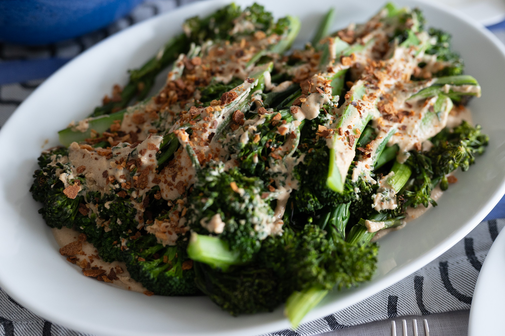
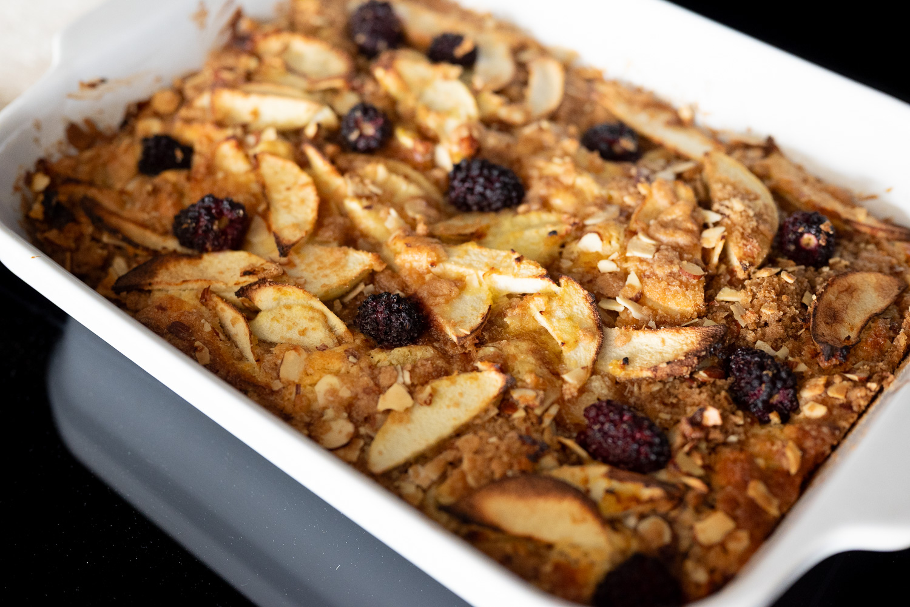
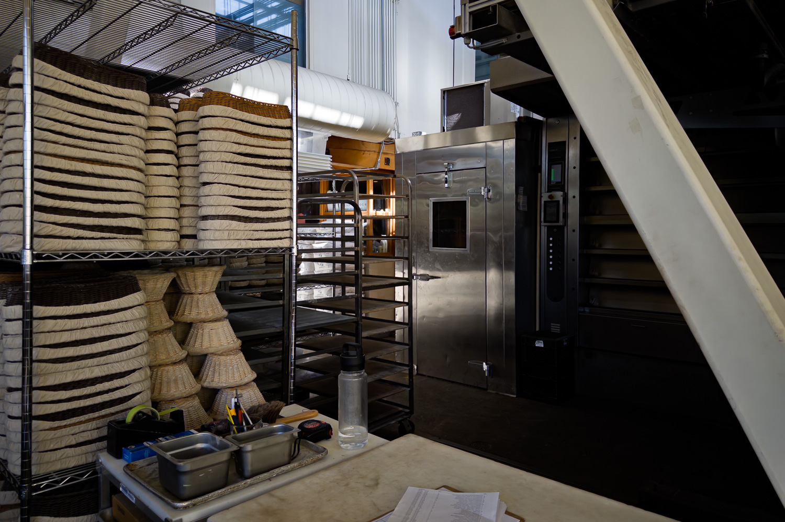
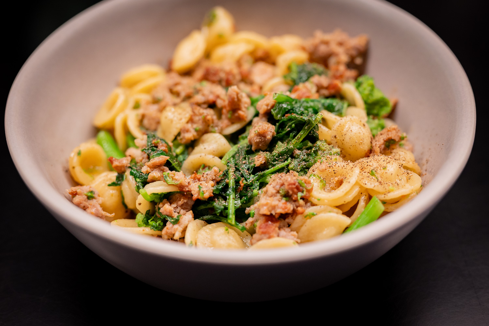
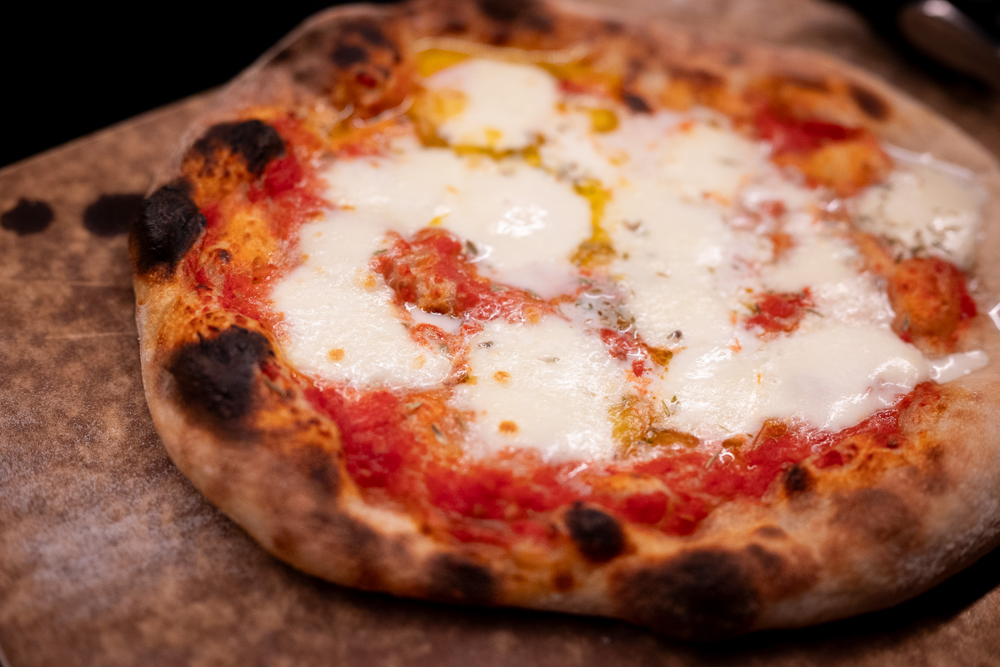

It's been another very busy month. Though with a few nice peaks from a food perspective.

For a group dinner, I followed through on my plan to channel the _bistronomique_ cooking I had at a couple of old and new favorites in Paris in September. I recreated something I've had a couple times at Le Saint Sébastien, a great tenderstem broccoli dish with a thick and generous dose of tahini sauce. 

It also gave me an excuse to finally test a technique from the people behind the Combustion Inc thermometer I got a year or two ago as a Christmas gift. Typically, I'd cook chicken breast pretty aggressively because no one wants to get food poisoning from chicken. The downside, of course, is that the chicken winds up being rubbery and dry.

In theory, you could look up rates that harmful bacteria are killed at certain temperatures, do some math, and figure out how to safely cook chicken to a much lower (and thus tastier) final temperature. But as much as I enjoy being fastidious, I've never bothered to do this. It's too much work even for me. This wireless thermometer's companion software does those calculations for you. So I gave it a try.



I still don't love the size of the probe on the Combustion product. One person had a piece of chicken with a gaping hole in the middle. Equally, though, the results were great. I got the chicken to temperature, held it for over an hour, and it was both delicious and very safe to eat.

As dessert, I did the apple-blackberry crumble cake for the umpteenth time. Part of me feels like I should be more experimental. But I'm increasingly convinced it's simply the best dessert.

I made a trip to San Francisco for a family event, and had a chance to try a few new places and once again revisit old favorites. Suffice to say the food scene is somewhat more vibrant in San Francisco than it is in Saint Louis. I revisited a few old favorites, like the always excellent SPQR, and was introduced to a few new places as well.

Back at home, there was a lot more comfort cooking. Partly because my energy levels were lower. Partly because every time I spend so much time eating at restaurants, I inevitably want the exact opposite. Peace, quiet, and simpler, more straightforward cooking.

Within that envelope, more of the usual suspects. I'm a real sucker for doing orecchiette with super bitter broccoli rabe and sausage. It's so easy, and the bitterness of the greens really works with the richness of the sausage. Keeping with the Italian theme, I spent more time noodling with levain-based pizza.

Likewise, I returned to the Poilâne rye cocoa cake, mostly, if I'm honest, because I needed something sweet and didn't want to have to go shopping to make something. While my supply of emergency chocolate was too depleted to make cookies, I had a ton of rye flour from my recent bread projects, and the cake comes together incredibly quickly. It only uses about 50 grams of cocoa powder, but still more than ticks the box of being a chocolate dessert.

Next month, it's Thanksgiving. I'm planning to host as has become tradition. I've never totally understood why people find roasting a turkey such a challenge. But I can feel myself getting better at carving it every year. While I like to apply technique, this is one holiday where I like to keep everything reasonably traditional. So the plan is the usual: turkey, mashed potatoes, brioche rolls, and all the other usual suspects. Plus, doubtless, one or two surprises from my guests.

Outside the big event, I realized I have a ton of chicken stock in reserve when I was trying to cram something large into my admittedly tiny freezer. That (plus a recent purchase of yet more excellent Rancho Gordo beans) clearly points to soup. And soup points to more excuses to make bread.

In a more ambitious direction, I came across this fantastic looking [remix of a clam chowder](https://www.instagram.com/reel/DfU2AWnibNh/?utm_source=ig_web_copy_link&srtk=NTc4MTIwNjQ2YQ==) from the team at Island Creek Oysters. Especially now that we're well and truly done with summer weather, the idea of a clam chowder in a pot pie format has a lot of appeal.

On a similar path, this recipe for faux black truffle from ChefSteps also caught my eye. This might be too much trouble for me to bother with, but I like the idea. Truffles are tasty, but their contribution doesn't feel commensurate with their cost. At least on my budget, I feel more at home spending big on great vanilla --- merely ten times or so the price of imitation extract --- than on black Périgord truffles.



### What I'm Reading and Watching

* The [peculiar battle](https://www.ft.com/content/a7d0b547-88e3-4a30-953c-9490f7be1aa5) over foie gras in this year's US midterm elections

* A [very FT guide](https://www.ft.com/content/ffb638bf-6b1d-4b16-bdd2-ddfb89103d1b) to downsizing your kitchen

* [Restaurant chain cross-pollination](https://laurenwlee.substack.com/p/welcome-to-zucks-village) in the Northeast

* The New York food scene has [fixated on its latest French staple](https://www.newyorker.com/culture/the-food-scene/a-parisian-sandwich-takes-new-york) in the form of the _jambon beurre_

* Whoogy's has [a new book out](https://www.youtube.com/watch?v=-lqjnlPXi30) that's on the top of my list for the next batch of French books I order

* The [linguistic puzzle](https://www.nytimes.com/2026/11/12/magazine/welcome-in-retail.html) that is "welcome in"

* A reminder that farmed salmon has serious issues, as aquaculture salmon in the UK [loses its organic certification](https://www.theguardian.com/environment/2026/nov/14/salmon-organic-british-farmed-environmental-welfare)

_[Subscribe](/subscribe) to get notified every month when new issues go out_

