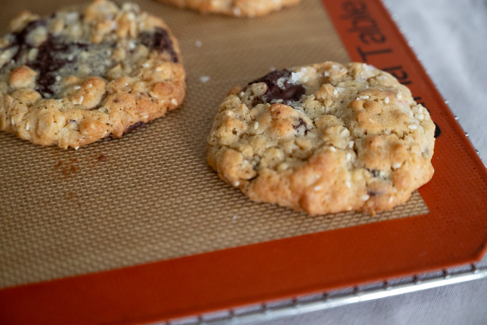
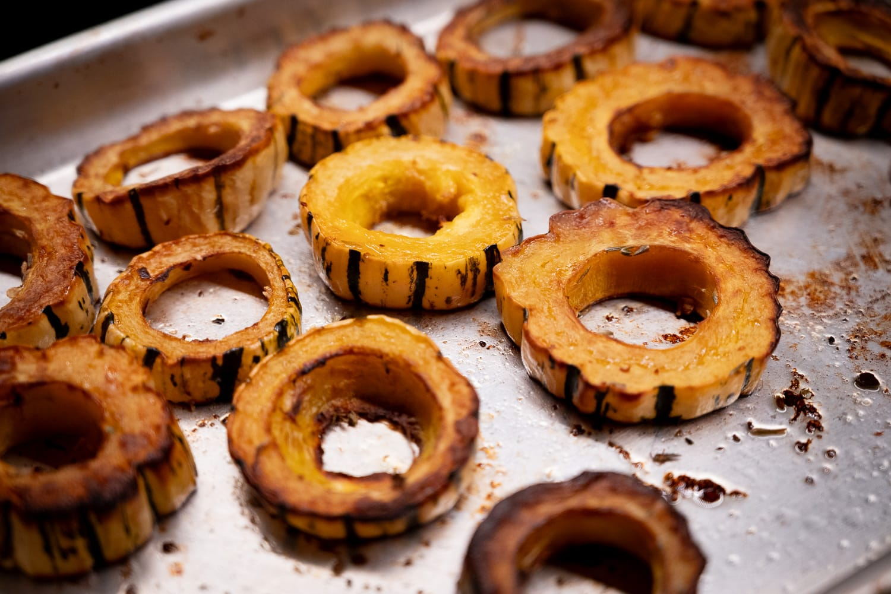
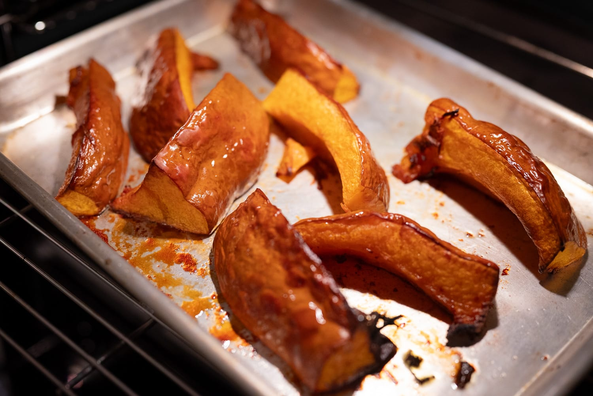
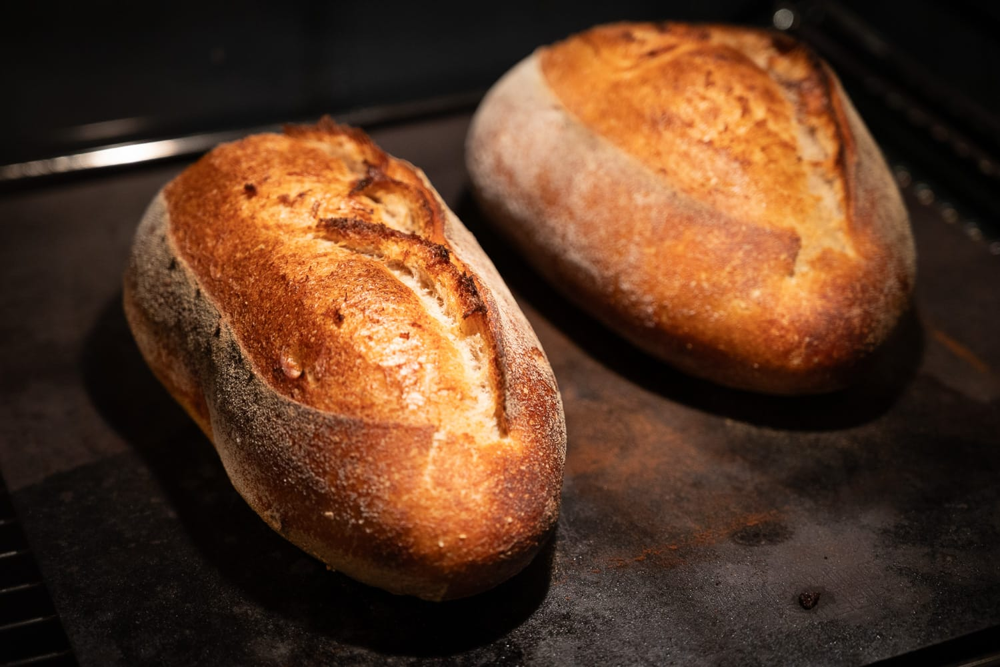
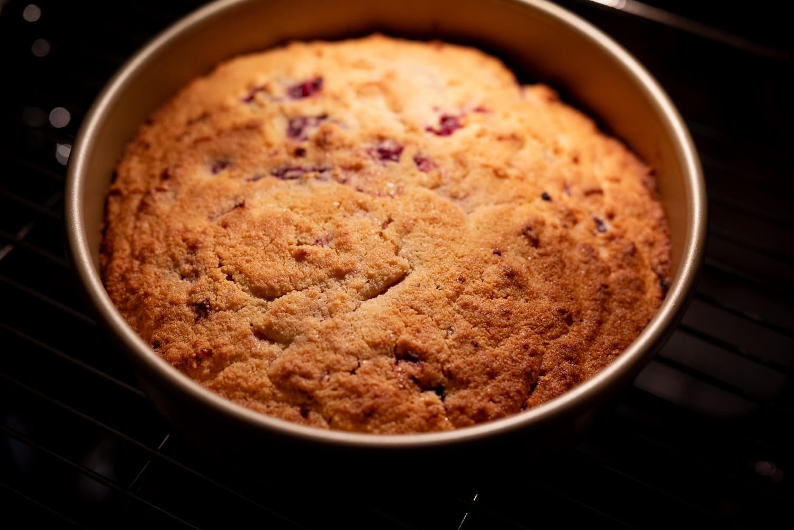
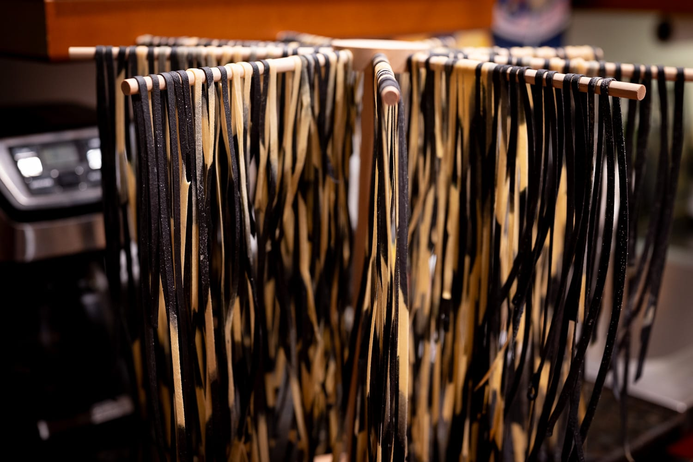

It's been a whirlwind few weeks since returning from my busy-but-fun swing through Europe.

After two weeks eating restaurant food all day every day, I had a real hankering for extremely simple food. Suffice to say I ate a lot of rice and lentils in the later part of September.

More experimentally, I had a chance to take the copy of the Mokonuts cookbook for a spin. On the negative side, I'm not that impressed with the quality of the book's writing. The instructions can be vague and hard to follow. On the plus side, it has a bunch of my favorites from the restaurant, which has been fun to play around with.

I started with a batch of the chocolate-sesame cookies, and I was pretty happy with them. They need a bit of tinkering, but that's mostly work I need to do rather than anything wrong with the recipes.

As the weather has trended more decidedly fall-like, I've adjusted what happens in the kitchen too. There are still a few good strawberries to be had. The fig season this year has felt tragically short. Squash has become available, however, and I've done that my favorite way: roasted, hot and fast to concentrate flavor. That's always tasty, though as I review the photos, we're back in very beige-orange territory.

My time in Paris revived my itch to do French breads, in particular loaves doped with a bit of rye flour for color, flavor, and character. I did a few 20% rye loaves, and was pretty happy with the results. I didn't quite get as much tang as I was hoping for from the levain. I'm not brave enough to return to the _tourte auvergnate_ that's become infamous for selling at $60 per loaf at a bakery in New York. WHile that price is clearly ridiculous, it is definitely the trickiest loaf I've ever attempted.

The unexpectedly early end to fig season also advanced my other dessert making. On one failed attempt to buy figs, I stopped at a grocery store on the way home to get some frozen raspberries for a never disappointing lemon-raspberry polenta cake. I'd have preferred to find figs. This was still a nice consolation prize.

Out of the house, I had the good fortunate to try some handmade pasta with a dark and moody twist. There were some issues with the food dye affecting the pasta's flavor. But overall, it was a pretty successful experiment.

I also had a chance to visit St Louis for the first time. While cute, its food scene isn't exactly setting the world on fire. It felt kind of like the place hasn't quite hit the threshold to be in a positively reinforcing feedback loop. Even though very few people in San Francisco will ever eat at The French Laundry, its existence, and the sheer number of people who've passed through, however briefly, clearly gives people a sense of what good looks like. Which raises the game for everyone else.

These concentrations of knowledge also explain how somewhere like Chicago, which isn't exactly close to the Mexican border, has such excellent Mexican food.

Pappy's, one of the barbecue places that was recommended, was pretty good. The rest was, if I'm honest, a bit disappointing.

The month to come also promises to be a bit busy.

I have another trip coming up that will take me somewhere that has, arguably, the best food scene in the US. There should be some good food adventures to come.

With a bit more time to myself, I'm also hoping to spend more time taking inspiration from my recent travels. For whatever reason, it's really hard to find what I'd call _cuisine bistronomique_ anywhere in the US. This is the sort of food you get somewhere like Le Mermoz, which I finally had a chance to try last month in Paris. There are a few ideas I have to mess around with in that direction.

Likewise, I feel compelled to adapt to the change of seasons, and do more with seasonal ingredients. Most immediately, that feels like baking with apples.

There are a few more recipes I want to try in the Mokonuts cookbook. There's a slightly quirky fish recipe using exotic split peas I'd like to sample, and there's a fun chocolate tart that could fill the void left by the lack of summer fruit.

In a similarly sweet direction, one of my favorite recipe channels did a triamisu with a decidedly Belgian twist, using Biscoff in addition to the usual ladyfingers. It sounds at once sacrilegious and delicious at the same time. I may need to give it a try, though perhaps incorporating the low-temperature egg treatment from the slightly over-thought recipe from James Hoffman.



### What I'm Reading and Watching

* Are [people hosting less](https://www.theguardian.com/lifeandstyle/2026/oct/08/dreadful-decline-hosting-home-shame-friendship) because their homes don't live up to picture-perfect Instagram lives?

* Another take on the [decline of the American host](https://www.derekthompson.org/p/the-death-of-the-american-host)

* A contemplation of a [perfectionist culture](https://www.bonappetit.com/story/will-guidara-unreasonable-hospitality-criticism) in the restaurant industry

* Farmed fish has entered a strange new era in which farmed salmon are [fed chicken](https://www.ft.com/content/8f1e2cc9-4e2a-48f0-9750-251585e345d3?syn-25a6b1a6=1)

* The rise and rise of ["natural" wines](https://www.theguardian.com/food/2026/oct/15/cloudy-wine-why-pet-nat-on-the-rise)

* [Hosting a tea party](https://www.ft.com/content/6a5f8dce-f276-417a-b904-44d6f2390b68), Korean style

_[Subscribe](/subscribe) to get notified every month when new issues go out_