It's been a busy food month, though not so much for what's gone on at home. I spent the bulk of the last month on vacation exploring Istanbul for the first time, and making my umpteenth visits to Paris and London.

For the second half of August, it was mostly favorites on repeat to use up food so I could leave my refrigerator as empty as possible. I had the better part of a decent bottle of red wine leftover from a dinner I hosted, and did one of those dishes that tastes much better than it looks. Namely a sort of cheat's _coq au vin_.

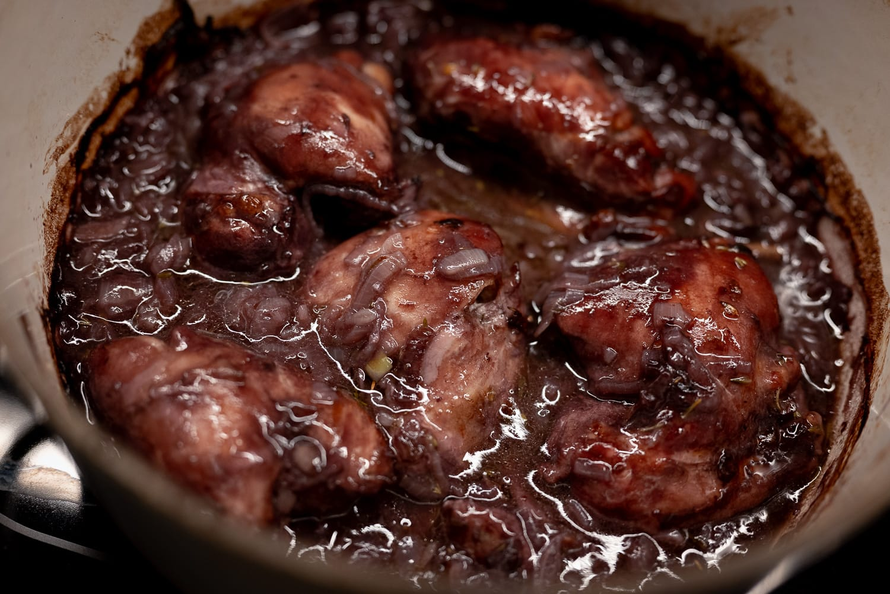

For a weeknight dinner, I really can't justify separately cooking all the components of a more traditional version. The mushrooms, the pearl onions, the lardons, and everything in between. You still get something very nice by sweating down some shallots and garlic, and then braising the chicken in red wine with thyme, bay, and star anise in a low oven for a couple of hours.

Admittedly, that's really not very seasonal. I think of a braise, especially one with a red wine, as something for short days and cold nights.

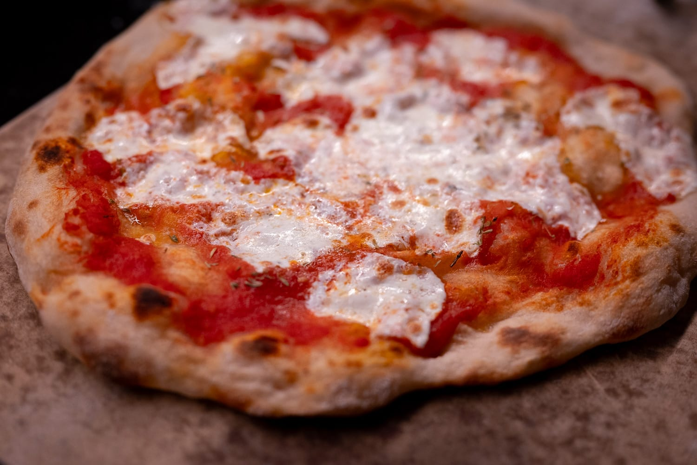

More in line with the time of year, I had one last run at doing pizza at home, to the extent that's possible without a special oven. As usual, just as peak pizza season is wrapping up, I felt like I was finally getting the hang of it again. I still feel like I can do better, but I wasn't too unhappy with this latest attempt either.

Back to using up the contents of my refrigerator, I had more good strawberries than I knew what to do with, and did this summer's first batch of lacto fermented berries. For whatever reason, I feel like strawberries work especially well with that technique.

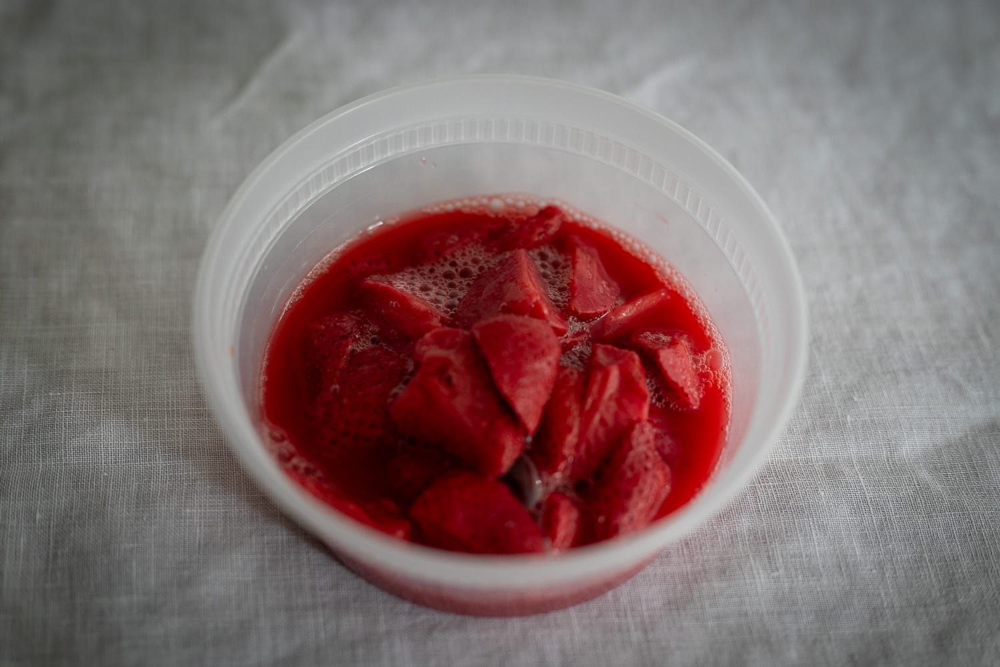

Out of the house, it was a very busy month.

For a friend's wedding, I had the opportunity to visit Istanbul (and thus Turkey) for the first time.

It was completely fascinating.

It's clear that people care about food. The culture doesn't have the slightly puritanical attitude we're still shaking off in the anglophone world. Even the people selling cheap kebabs on the streets in the most tourist-filled parts of the city seemed to really care --- or at least made noises to pretend to --- care about what they were making.

Equally, it's clear that the country --- or at least its largest city --- is in flux.

My Turkish sources all suggested pretty unanimously that I shouldn't take the risk potential issues and drink only bottled water. It's the first time I've been in a place where that's been necessary, and it annoyed me more than I would've expected. There was no way I was going to pay the exorbitant prices for the dinky bottles of water in my hotel room. So I wound up navigating my way through a local Carrefour to lug back a few 2 liter bottles of water. Clean drinking water is the luxury I never knew I cared so much about.

I took a certain amount of pleasure in asking for tap water when I got to Paris after the Istanbul segment.

It was also interesting how the food hasn't been infected with a certain strain of global city sameness. I had to get used to the fact that an "omelette" in Istanbul isn't the same as the French version that I think of as the benchmark, or the version that people think of in the US, like a Denver omelette.

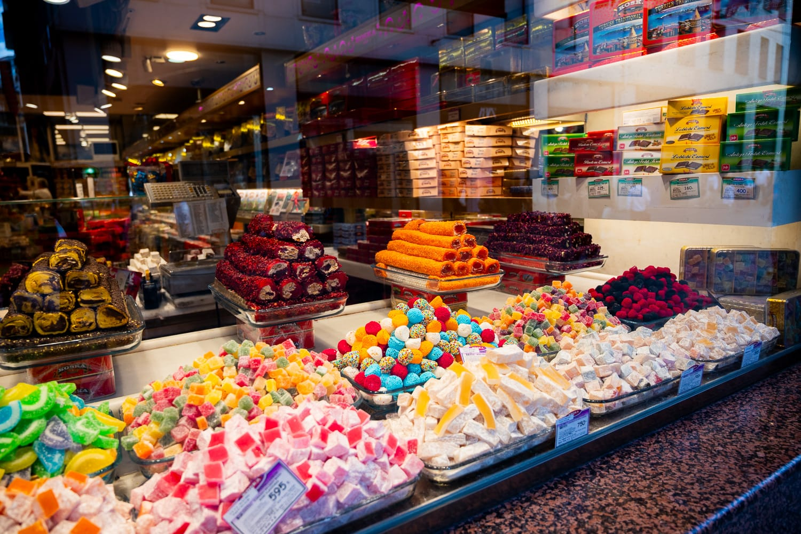

Similarly, it was fun to feel the push and pull of the very different breakfast culture. There was a part of me that resisted. I wanted my overnight oats, laminated pastry, and delicate Chinese green teas. There was also a part of me that enjoyed being forced to try something different.

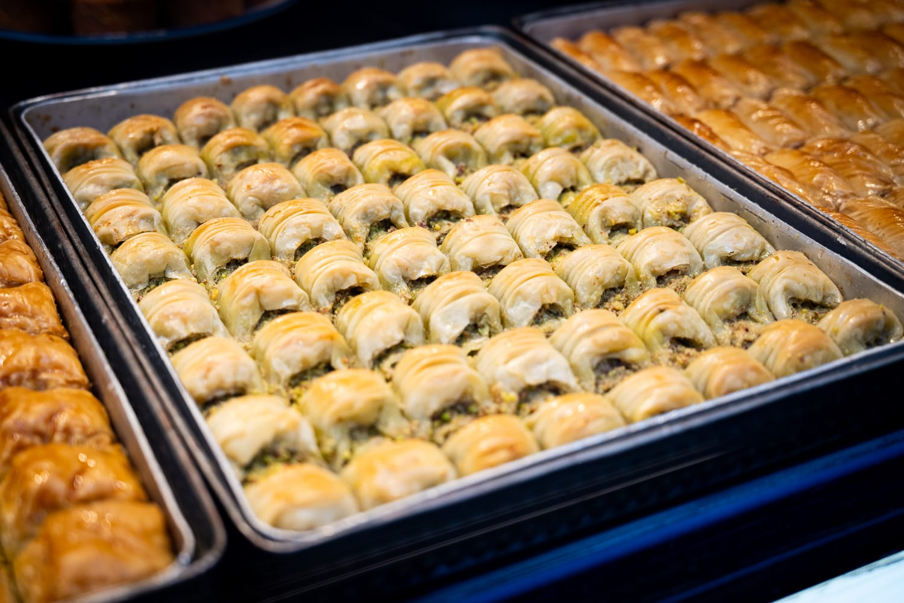

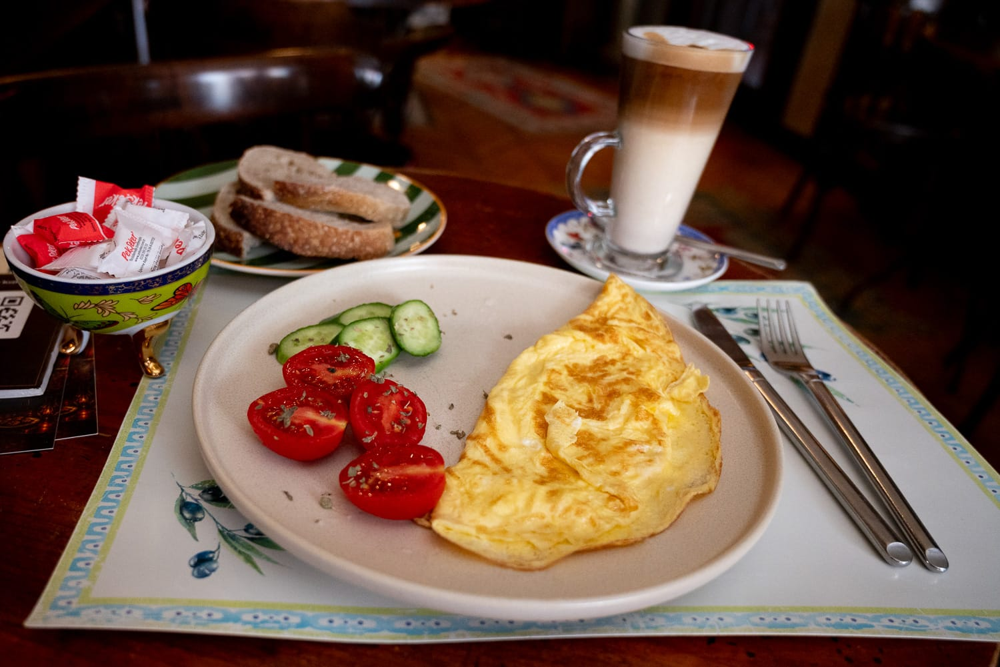

I found a few bakeries that were pretty good. If I'm honest, though, I wasn't bowled over by the more ambitious restaurants that I tried. They lacked the verve and pop of restaurants in places with more mature food scenes, and the execution lacked a certain level of refinement. On top of which, the food wasn't really any cheaper than places like London or Copenhagen. It didn't feel like good value in the way it did the last time I was in Spain.

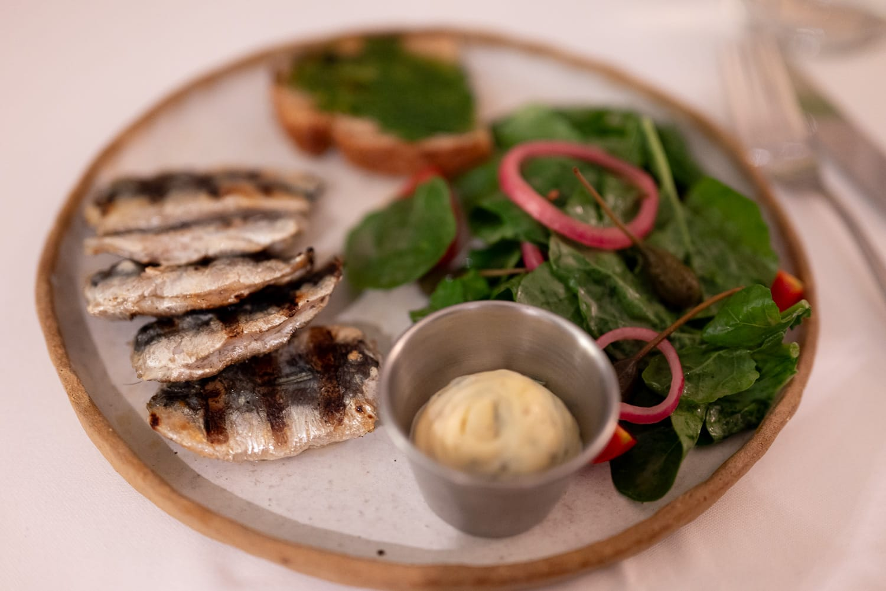

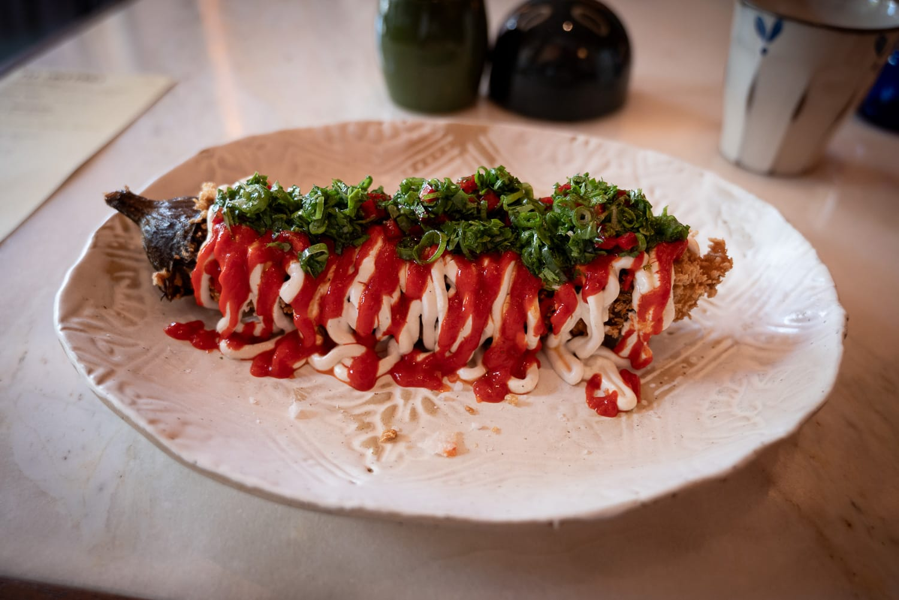

Paris, meanwhile, continues to be one of my favorite places for food. Maybe I'm a bit biased. Nothing gives me more joy than going to a bakery and ordering a great croissant.

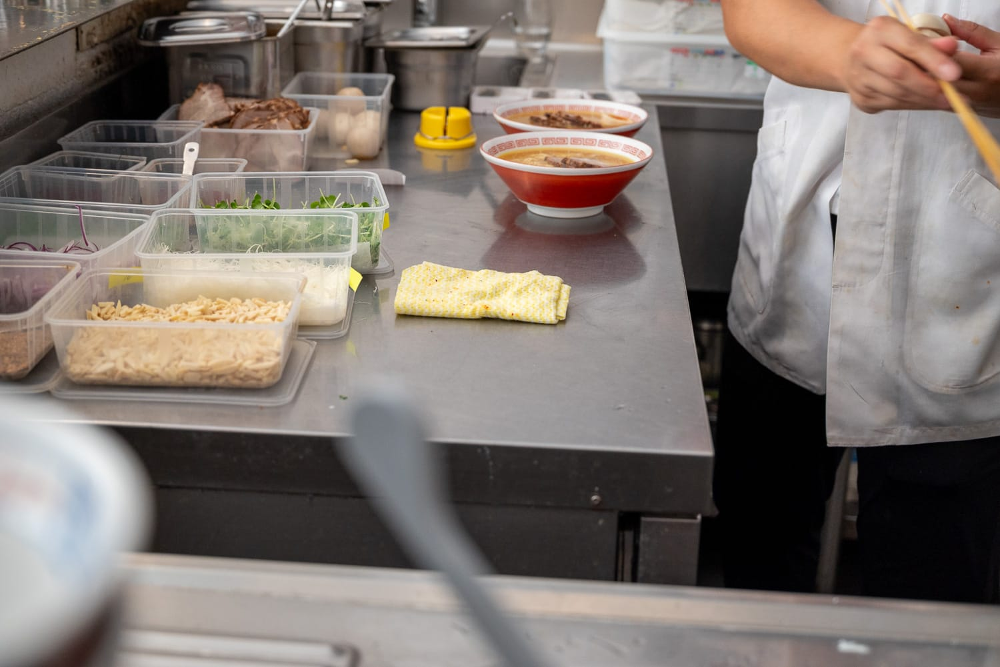

But as I'm forever telling people, Paris is more than baguettes and Café de Flore. I made a return visit to a few favorite places, including Le Saint Sébastien and Sanjo, a favorite Japanese restaurant, for lunch. Sanjo especially is astoundingly good value. For about the price of a nice sandwich in a major US city, you can get an actual hot meal with table service. If anything, it was cheaper than Istanbul.

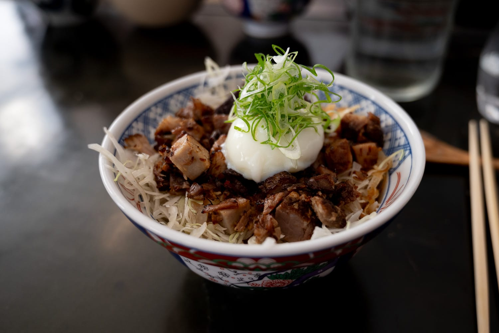

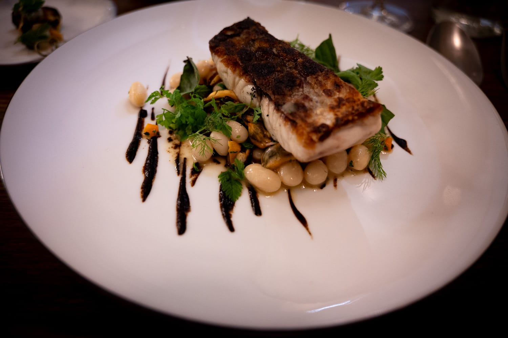

I also had a chance to try a couple places, such as Le Mermoz, that have been on my list for ages, and I haven't managed to try. And then a relatively new restaurant, Double Impact, from a chef whose food I ate a few years ago at a pop up. That was, by a long way, the best and most interesting meal I've had all year. Like Next in Chicago, they're running on a regular theme or (in their case) chapters. Their first was "The Odyssey" by coincidence. (I had a long chat with the chef at the end of the meal, and they'd been planning it for months with no idea the Christopher Nolan film would take off the way it did.)

It was an incredibly fun experience with all kinds of flavor combinations I never would've reached for. For example, an all-black dish served on an all-black plate that paired octopus and roasted peanuts. It shouldn't have worked and was ridiculously theatrical, but it all gelled. It was a true remix of Mediterranean food.

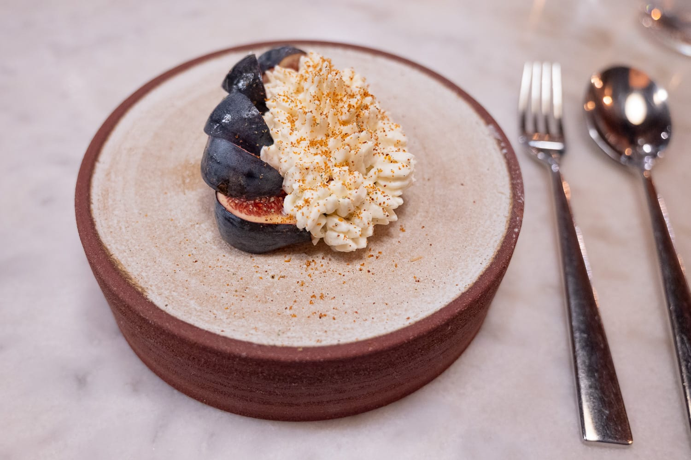

In London, the food scene is somewhere in between what I found in Istanbul and Paris. Like the US, they don't have the same robust culture of independent restaurants. There are lots of chains and restaurant groups that really dominate the market. And there are still tons of restaurants that serve, to my eyes, very questionable old-style food. I'd take a kebab on the streets of Istanbul over beans on toast any day.

But there's also so much vibrancy. I had great Southeast Asian food for lunch and, despite it being a local chain, I love Leon. After weeks of eating super rich restaurant food, there's something great about being able to get slow-cooked, richly spiced black beans on rice in what otherwise looks like a fast food shop. There's no shortage of great bakeries.

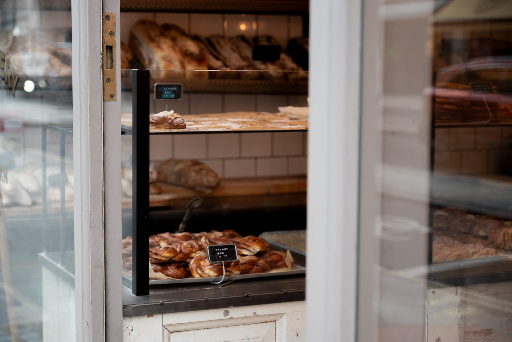

Of course, I had to make a stop at a couple different outposts of the Ottolenghi empire. I had lunch at one of his cafés, and booked in for dinner at Nopi one evening. That was really excellent from beginning to end.

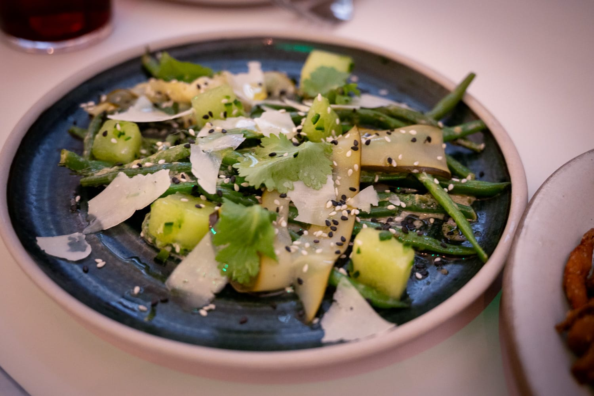

Looking to the month ahead, I have a bit more travel in store. For better or worse, it's not to somewhere with quite as much of a food scene as the places I went in the last month.

In Paris, I did my usual book shopping, and, among other things, finally picked up a copy of the Mokonuts cookbook. I didn't have a chance to make a return trip when I was in the city, but I'm looking forward to recreating and remixing a few of their dishes. Their sesame chocolate cookies are a favorite, and I'm very curious to compare my earlier attempts at reverse engineering with the formula from the source.

While the weather holds, I'm clinging to the abundance of summer. In particular, I'm still on the hunt for great figs, and I want to pick up a few more strawberries before that season ends.

And honestly, after so much time trying so many great restaurants, there's also a part of me that wants to eat very simple, light food. On my first day back from my trip, I wanted nothing more than some red lentil dal on rice with a huge handful of cilantro.

### What I'm Reading and Watching

* Blank Street, with no obvious signs of running a sustainable business, looks to [continue expanding](https://www.ft.com/content/c202d7aa-481a-466b-b34f-2c4451f787a5?syn-25a6b1a6=1)

* Increasing suspicion that the Michelin restaurant guide process is [being understaffed](https://www.theguardian.com/food/2026/aug/31/chefs-say-michelin-guide-at-risk-of-losing-credibility-over-suspected-lack-of-inspectors)

* Nigella Lawson on the [joys of baking](https://www.ft.com/content/048f6e67-d911-4c93-aedd-fbe67e5c0ed5?syn-25a6b1a6=1)

* Danny Meyer, of Shake Shack and Gramercy Tavern fame, has [a new memoir](https://www.nytimes.com/2026/09/14/dining/danny-meyer-hospitality-book.html) out

_[Subscribe](/subscribe) to get notified every month when new issues go out_
